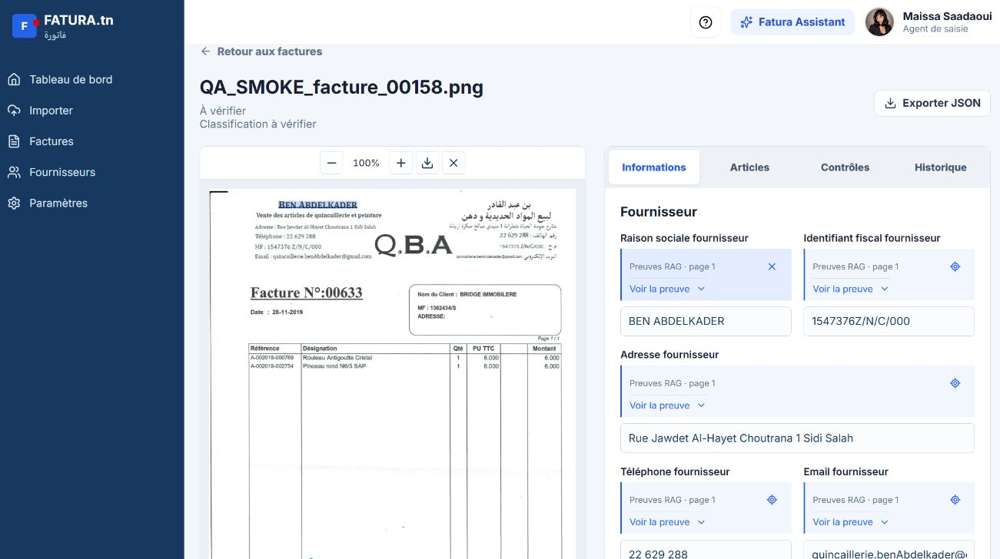
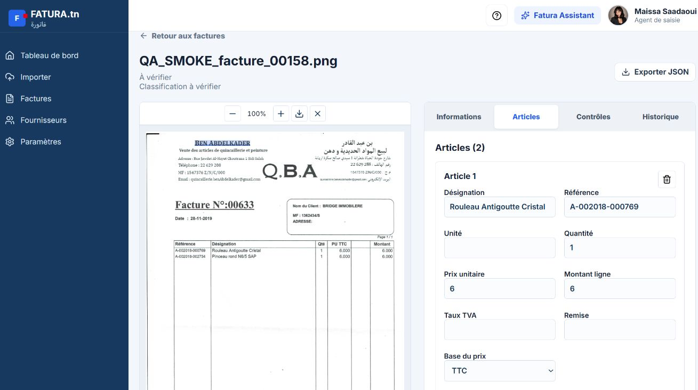
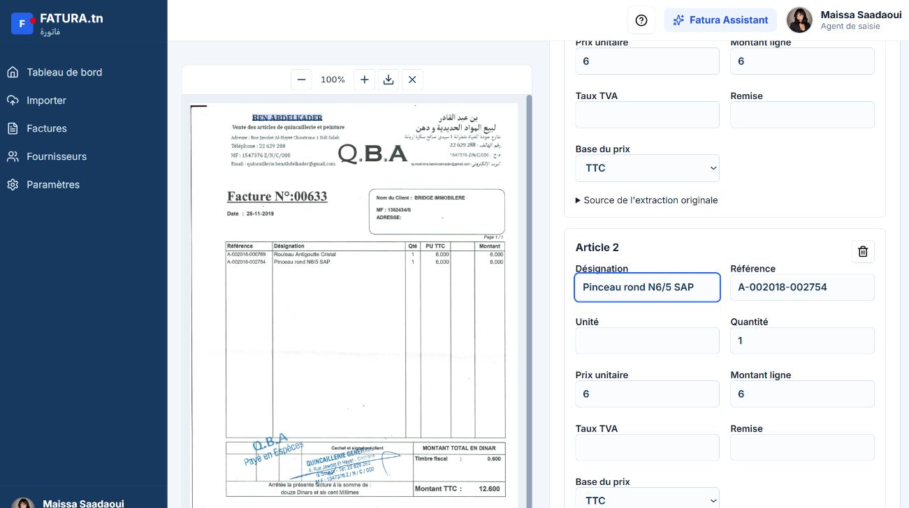
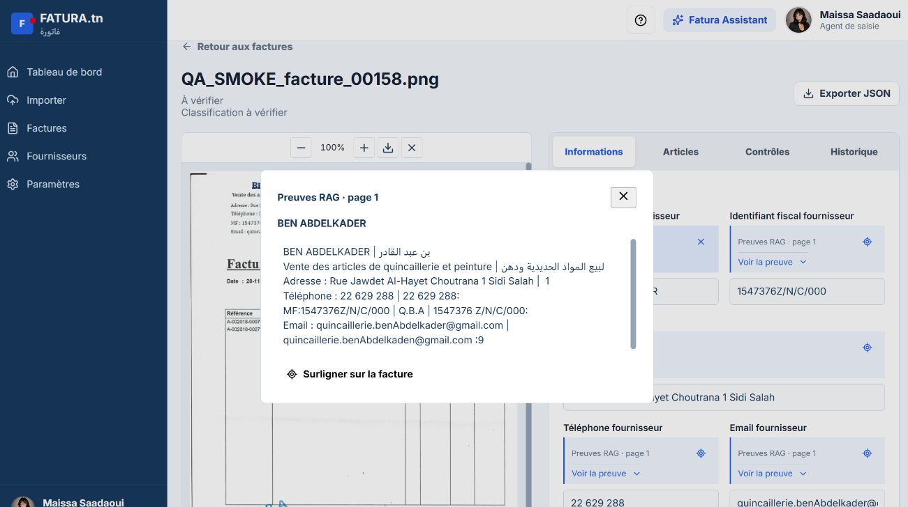
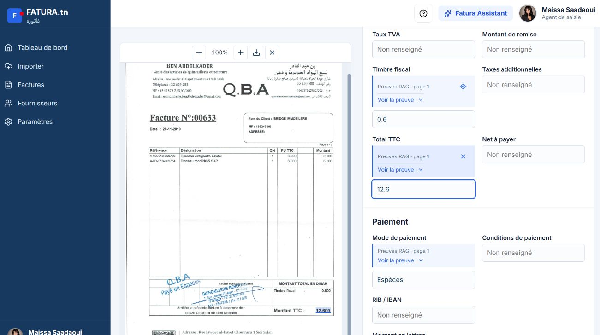

# FATURA.tn

Application d'aide a la saisie des factures : extraction documentee, preuves
consultables et validation humaine. Le resultat automatique reste un brouillon
jusqu'a sa verification.

## Demonstration : resultats reels

Captures de l'application locale prises le 19 octobre 2026 sur la facture de
test `00158`, avec autorisation de publication. Il s'agit des donnees deja
enregistrees, pas d'une nouvelle execution OCR/LLM ni d'un benchmark.

Le nom du fichier est `facture_00158`, mais le numero imprime est **00633**.



| Resultat observe | Valeur |
| --- | --- |
| Numero de facture | 00633 |
| Date | 28-11-2019 |
| Fournisseur | BEN ABDELKADER |
| Articles retrouves | 2 |
| Prix unitaires | 6,000 et 6,000, en TTC |
| Timbre | 0,600 |
| Total TTC imprime | 12,600 |
| Paiement | Especes |
| HT et TVA | Non renseignes : ne pas les inventer |

La capture conserve volontairement l'etat **A verifier**, les champs vides et
les imperfections OCR. Par exemple, le nom client contient encore la graphie
OCR `BRIDGE IMMOBILERE`. Une capture de resultat n'est pas une certification
de l'exactitude de tous les champs.

### Articles

Le formulaire conserve les references, quantites, prix et la base HT/TTC.





### Preuves et surlignage

Un clic ouvre le passage source. Lorsque des coordonnees sont disponibles,
le champ peut etre localise sur l'image ou le PDF. Une correction humaine
reste distinguee de la preuve de la valeur originale.





## Fonctionnalites

- Connexion et sessions backend.
- Import d'images/PDF, classification et creation d'un brouillon.
- Champs fournisseur/client, identifiants, montants et articles editables.
- Enregistrement, annulation, confirmation de validation et historique.
- Preuves par champ, apercu image/PDF, surlignage et export JSON.
- Tableau de bord et fournisseurs issus des donnees enregistrees.
- Fatura Assistant sous forme de panneau de conversation.

La reinitialisation du mot de passe par email n'est pas configuree.
Les scores de detection ne certifient pas l'authenticite d'une facture.

## Pipeline actuel

```text
Document image/PDF
  -> OCR / texte PDF et structure des tableaux
  -> classification
  -> retrieval des preuves
  -> extraction LLM
  -> grounding / mapping
  -> regles et validation financiere
  -> brouillon corrige et valide par un humain
```

| Couche | Technologies / configuration |
| --- | --- |
| Interface actuelle | React 19, TypeScript, Vite, Lucide, Recharts, PDF.js |
| API | Python, FastAPI |
| OCR local valide | PaddleOCR et reconstruction spatiale; Tesseract / texte PDF selon configuration |
| Detection visuelle | Ultralytics / YOLO, selon les poids configures |
| RAG d'extraction | Chunking legacy, BM25 + all-MiniLM-L6-v2 + RRF |
| Options conservees | Chunking layout, BGE-M3 en haute qualite |
| Extraction | Groq GPT-OSS-120B; adaptateur Ollama configurable |
| Stockage local | SQLite et documents sur disque |
| Stockage heberge | Adaptateurs PostgreSQL / JSONB et fichiers BYTEA |

Les valeurs sans preuve ne doivent pas etre fabriquees. Les controles financiers
signalent la coherence sans remplacer un montant imprime par un calcul.
Les quotas du fournisseur LLM peuvent interrompre une extraction.

## Organisation du depot

```text
backend/              API, OCR, retrieval, grounding, stores et tests
web/                  Interface React/Vite actuelle
models/extraction/    Poids YOLO du projet
assets/               Ressources backend
docs/                 Notes de deploiement et captures
data/                 Donnees locales ignorees par Git
```

`web/` est une copie versionnee de l'interface locale `Desktop/Front`.
L'ancien dossier Next.js `frontend/` present sur la machine n'est pas
l'interface actuelle et n'est pas ajoute dans cette mise a jour.

## Demarrage local

### Backend

Installer Python et les dependances systeme des moteurs OCR utilises.
Les poids des modeles doivent etre disponibles; ils ne sont pas tous inclus
dans le depot. Les versions de dependances doivent etre verifiees pour
l'environnement cible, notamment Paddle et PyTorch CPU.

```powershell
cd backend
python -m venv .venv
.venv\Scripts\Activate.ps1
pip install -r requirements.txt
Copy-Item .env.example .env
```

Configurer `.env` sans jamais le committer :

- pour SQLite local : laisser `DATABASE_URL` vide et `REQUIRE_POSTGRES=false`;
- pour Groq : `INVOICE_LLM_PROVIDER=groq` et une cle serveur `GROQ_API_KEY`;
- conserver `RAG_CHUNKING_MODE=legacy` et `RAG_EMBEDDING_MODEL=minilm`;
- pour le pipeline Paddle : `ENABLE_PADDLEOCR=true` et `OCR_TEXT_ENGINE=paddle`;
- adapter les chemins de modeles et de stockage a la machine.

Le fichier exemple est un gabarit, pas une copie de la configuration privee
du poste. Ne pas supposer qu'un modele local est pret simplement parce que
son nom est configure.

```powershell
python -m uvicorn main:app --host 127.0.0.1 --port 8002
```

### Frontend

Dans un second terminal :

```powershell
cd web
npm ci
Copy-Item .env.example .env.local
npm run dev -- --port 5176 --strictPort
```

Ouvrir [Fatura en local](http://127.0.0.1:5176).
`VITE_API_BASE_URL` doit pointer sur `http://127.0.0.1:8002` en local.
Aucune cle de fournisseur LLM ne doit utiliser un prefixe `VITE_`.

## Verifications

```powershell
cd web
node --test tests/reviewData.test.mjs
npm run build
```

La derniere verification locale du parcours UI a confirme **443 tests backend**
et **11 tests frontend**, ainsi qu'un test correction/validation sur une copie
SQLite isolee. Aucun nouvel appel OCR ou Groq n'a ete fait pour les captures.

Une partie des tests backend depend de traces QA privees dans
`backend/qa-results/`. Ces fichiers ne sont pas publies. La suite complete
n'est donc pas reproductible telle quelle depuis un clone sans ces fixtures.
Les tests independants des traces peuvent etre executes separement :

```powershell
cd backend
python -m unittest test_invoice_store test_extraction_guards test_groq_analyzer test_party_contacts
```

Cette verification ne remplace pas un smoke test frais du service heberge.

## Hebergement : limites importantes

- L'interface publique existante est sur Vercel.
- Le backend Render actuellement observe utilise un profil allege.
- `backend/Dockerfile.free` desactive PaddleOCR, YOLO et les embeddings
  Sentence Transformers : ce n'est pas l'equivalent du pipeline local.
- Le controle public du 19 octobre 2026 a constate que `/database/stats`
  repondait sans authentification. Les routes documentaires, les inscriptions
  et les droits entre comptes doivent etre securises avant toute migration
  de factures confidentielles.
- Les fichiers locaux et bases SQLite ne doivent pas etre copies sur un
  disque ephemere en esperant qu'ils persistent.
- La base PostgreSQL existante, son offre et sa politique de conservation
  doivent etre verifiees dans les tableaux de bord des fournisseurs.
- Aucun transfert de base, changement d'offre ou redeploiement n'est realise
  par cette mise a jour documentaire.

Voir le [guide de deploiement](docs/RENDER_FREE.md) et les
[limites du stockage heberge](backend/FILE_STORAGE.md).

## Donnees et secrets

Les bases SQLite, comptes, sessions, journaux, cles API, archives du dataset
et traces QA restent locaux. Seules les captures de la facture de test
autorisee sont ajoutees a la documentation. Le consentement pour ces captures
ne vaut pas autorisation de publier les autres factures.

Les regles `.gitignore`, `.dockerignore` et `.vercelignore` ne retirent pas
un secret deja present dans l'historique Git. Inspecter le contenu avant
publication et faire tourner toute cle exposee.
